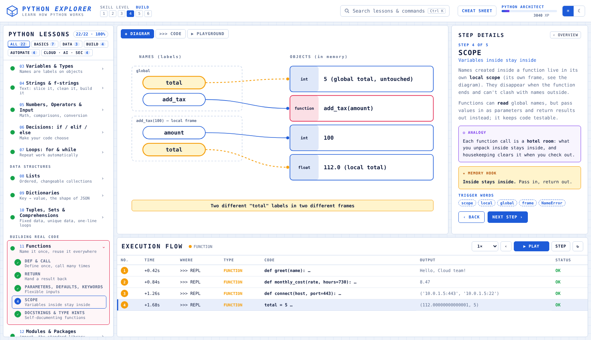

# 🐍 Python Explorer — learn how Python works

An interactive, step-by-step Python course for **Cloud, AI Automation and Cyber Security** learners. No data science, no math detours: just the Python you need for AWS, APIs, automation scripts, security tooling and AI endpoints.

Every lesson has an **animated diagram** (including memory diagrams showing names → objects), a **code view** that types real examples with real output, an **execution-flow log**, plain-English **analogies**, **memory hooks**, **trigger words**, a **quiz**, and a **challenge you solve by writing real Python** in the browser.

> Created by **Raul** ([@rmctech-ai](https://github.com/rmctech-ai)) · Freelance AI Automation Specialist on the path to Cloud Security.
> Companion course: [Linux Explorer](https://github.com/rmctech-ai/linux-explorer).
> Layout framework inspired by [Protocol Explorer](https://protocol-explorer-alpha.vercel.app/) by Dilum Sanjaya.



---

## ▶ Run it

No build step. Plain HTML/CSS/JS.

```bash
python3 -m http.server 8000     # then open http://localhost:8000
```

The **Playground** runs real CPython in your browser via [Pyodide](https://pyodide.org) (WebAssembly). It downloads once (~10 MB) the first time you press RUN, then it's cached. Needs an internet connection for that first load.

### Publish on GitHub Pages
```bash
git init && git add . && git commit -m "Python Explorer: interactive Python course"
git branch -M main
git remote add origin https://github.com/rmctech-ai/python-explorer.git
git push -u origin main
```
GitHub → **Settings → Pages → Deploy from a branch → `main` / root → Save**.
Live at `https://rmctech-ai.github.io/python-explorer/`.

---

## 🧭 How to use it

| Area | What it does |
|---|---|
| **Python Lessons** (left) | 22 lessons in 5 tracks. Click to expand steps. Dots show progress. |
| **Diagram** tab | Memory diagrams (labels → objects, function frames), flow diagrams (APIs, Lambda, boto3), project trees. |
| **>>> Code** tab | Types out the step's code REPL-style with the real output. |
| **Playground** tab | Real Python editor. `Ctrl+Enter` runs, Tab = 4 spaces, auto-indent after `:`. Variables persist between runs (like a notebook). 21 lessons have an auto-checked challenge. |
| **Step Details** (right) | Explanation, **Analogy**, **Memory Hook**, **Trigger Words**, cloud/security notes, warnings. |
| **Execution Flow** (bottom) | Every snippet so far: where it ran, type, output, status (OK or the exception name). |
| **XP & levels** | From HELLO WORLDER to PYTHON ARCHITECT. Saved in your browser. |
| **Cheat Sheet** | Every lesson's master hook + key syntax (also [`CHEATSHEET.md`](CHEATSHEET.md)). |

**Keyboard:** `→` / `←` steps · `Space` play · `Ctrl+K` search · `Esc` close.

---

## 📚 Curriculum (22 lessons · 110 steps · 88 quiz questions · 21 coding challenges)

| # | Lesson | Track | You'll learn |
|---|---|---|---|
| 01 | Meet Python | Basics | interpreter, REPL vs scripts, print, indentation |
| 02 | Set Up Like a Pro | Basics | VS Code, uv/venv, packages, .env, .gitignore, Ruff |
| 03 | Variables & Types | Basics | names → objects, int/float/str/bool/None, aliasing |
| 04 | Strings & f-strings | Basics | slicing, strip/split/join, f-string formatting |
| 05 | Numbers, Operators & Input | Basics | / // % **, conversion, comparisons, and/or/not |
| 06 | Decisions: if / elif / else | Basics | branches, truthiness, one-line choices, match |
| 07 | Loops: for & while | Basics | range, while + retries, break/continue, enumerate, zip |
| 08 | Lists | Data | append/remove/pop, sorting, the aliasing trap |
| 09 | Dictionaries | Data | .get(), .items(), nested JSON-shaped data |
| 10 | Tuples, Sets & Comprehensions | Data | unique IPs, set math for port audits, one-line loops |
| 11 | Functions | Build | def/return, defaults, keyword args, scope, type hints |
| 12 | Modules & Packages | Build | import, standard library, your own modules, import errors |
| 13 | Errors & Exceptions | Build | reading tracebacks, try/except/else/finally, raise, retries |
| 14 | Classes & Objects | Build | class, \_\_init\_\_, self, methods, dataclasses, SDK objects |
| 15 | Files, Paths & CSV | Automate | with open, pathlib, glob, csv.DictReader |
| 16 | JSON & APIs with requests | Automate | json, GET/POST, status codes, auth headers, n8n webhooks, SAP OData |
| 17 | Secrets & Config | Automate | env vars, .env, config validation, AWS Secrets Manager |
| 18 | Automation Scripts | Automate | argparse, logging, subprocess, exit codes, cron/EventBridge |
| 19 | Python for Security | Cloud · AI · Sec | regex log parsing, brute-force detection, hashing, secrets, port checks |
| 20 | AWS with boto3 | Cloud · AI · Sec | credential chain, clients, S3, EC2, paginators, ClientError |
| 21 | AWS Lambda in Python | Cloud · AI · Sec | handler, event shapes, HTTP responses, roles, limits |
| 22 | FastAPI + Claude API | Cloud · AI · Sec | routes, Pydantic, anthropic SDK, AI endpoint, secure deploy |

---

## 🗂 Structure

```
python-explorer/
├── index.html
├── css/style.css
├── js/
│   ├── app.js          # navigation, rendering, XP, playground, search
│   ├── diagram.js      # SVG scenes: graph / tree / mem (names → objects)
│   ├── icons.js
│   ├── py.js           # Pyodide loader + runner (real Python in browser)
│   └── lessons/        # ALL content: 01-basics, 02-data, 03-build, 04-automate, 05-cloud
├── tools/
│   ├── validate.js         # node tools/validate.js js/lessons
│   └── build-cheatsheet.js # node tools/build-cheatsheet.js
├── CHEATSHEET.md
└── docs/screenshots/
```

**Challenges** are defined per lesson as `challenge: { task, hint, starter, check }`. `check` is a Python expression evaluated after your code runs; `__out__` holds what you printed.

## 🎯 Suggested 4-week plan

- **Week 1:** Lessons 1–7 (basics). Do every Playground challenge.
- **Week 2:** Lessons 8–14 (data + building real code).
- **Week 3:** Lessons 15–18 (automation). Build one script for a real task.
- **Week 4:** Lessons 19–22 (security, boto3, Lambda, FastAPI + Claude), then the capstone.

**Capstone:** "AI Invoice Summarizer": FastAPI + Claude endpoint → deployed on EC2 (systemd) or Lambda → key in Secrets Manager → logs in CloudWatch → called from an n8n workflow → pushed to GitHub.

## License
MIT © 2026 Raul (rmctech-ai)
